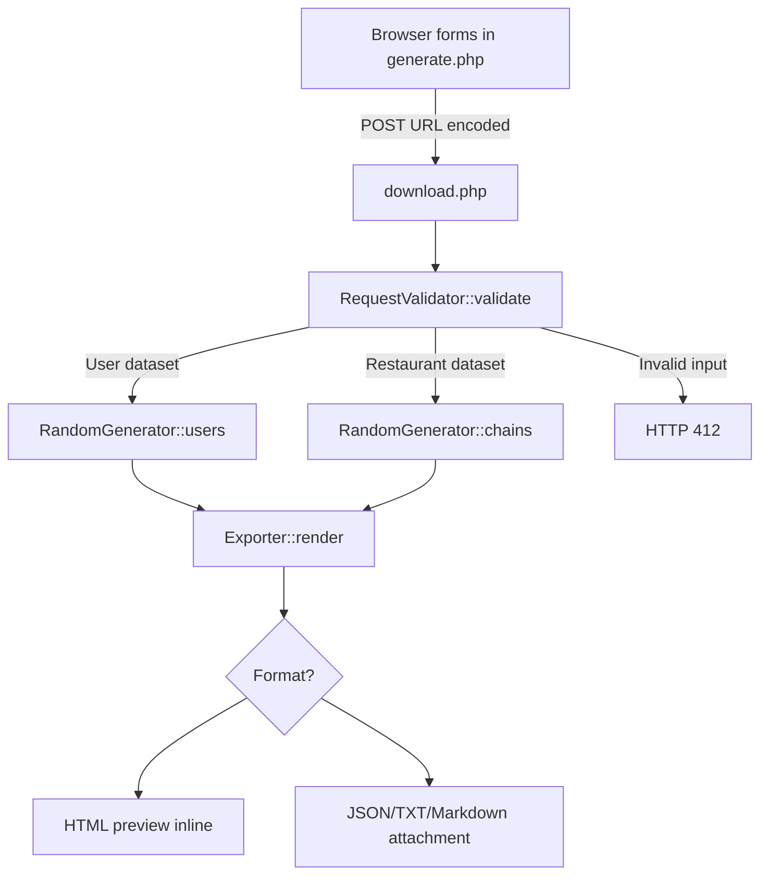

# Requirements traceability — Downloadable Lorem Ipsum (2)

## Source and primary goal

Source: the Recursion assignment screenshot provided with this project. It explicitly describes a new `download.php` POST handler that generates User objects via `RandomGenerator::users($count, $count)` and renders HTML/JSON/TXT/Markdown. A later extension asks for a configurable restaurant chain generator with employee count, salary range, location count and ZIP code range. A user form submits these values. The screenshot illustrates PHP even though its course navigation includes a JavaScript/Node.js language selector.

| ID | Requirement from screenshot | Implemented in | Test method | Result | Outstanding |
|---|---|---|---|---|---|
| R01 | `download.php` handles form POST | `download.php` | HTTP POST test | Pass | — |
| R02 | Read user-supplied parameters | `download.php`, `RequestValidator::validate` | HTTP and unit tests | Pass | — |
| R03 | Generate requested number of User objects | `RandomGenerator::users` | `tests/run.php`; HTTP JSON count | Pass | — |
| R04 | Allowed user count between 1 and 100 | `RequestValidator::integer` | tests for 0, 101, decimals, arrays | Pass | — |
| R05 | Output format `json` | `Exporter::render` | JSON parse and response headers | Pass | — |
| R06 | Output format `txt` | `Exporter::render` | content/disposition tests | Pass | — |
| R07 | Output format `md` (Markdown) | `Exporter::render` | content/disposition tests | Pass | — |
| R08 | Default HTML rendering | `Exporter::render` | valid full-page HTML and escaping | Pass | — |
| R09 | Download attachment for JSON/TXT/MD | `download.php`, `Exporter::render` | Content-Disposition tests | Pass | — |
| R10 | Detect missing parameters and invalid types | `RequestValidator::validate` | HTTP 412 and units | Pass | — |
| R11 | Respond with status 412 for bad input | `download.php` | HTTP invalid-input test | Pass | — |
| R12 | Build `generate.php` HTML form | `generate.php` | HTTP GET/form inspection | Pass | — |
| R13 | Restaurant-chain extension: number of employees | `generate.php`, `RandomGenerator::chains` | exact total per chain | Pass | — |
| R14 | Restaurant-chain extension: salary range | same | bound and equal-limit tests | Pass | — |
| R15 | Restaurant-chain extension: location count | same | exact location count | Pass | — |
| R16 | Restaurant-chain extension: ZIP code range | same | bound and leading-zero tests | Pass | — |
| R17 | Extension: output HTML, JSON, TXT or MD | `Exporter::render`, second form | all four HTTP tests | Pass | — |
| R18 | Preserve Restaurant Chain Mockup class model | PHP classes in `src/Models/`, interface | inheritance and conversion tests | Pass | — |
| R19 | Provide running browser UI similar in function to illustration | `generate.php`, `assets/styles.css` | HTTP GET and Chromium rendering | Pass for local rendering | Exact pixel matching not required |
| R20 | Deliver usable project + docs + tests + learning materials | `README.md`, `docs/`, `learning/`, tests | ZIP audit/retest | Planned final audit | — |

## Data and responsibility mapping

## Not prescribed in the screenshot

Actual Faker/composer source files, concrete class constructors, exact field names on the extension form, localization, salary units, and whether count means employees per chain or per restaurant are not fully specified. Chosen interpretations are itemized in `docs/assumptions.md` instead of presented as original requirements.
