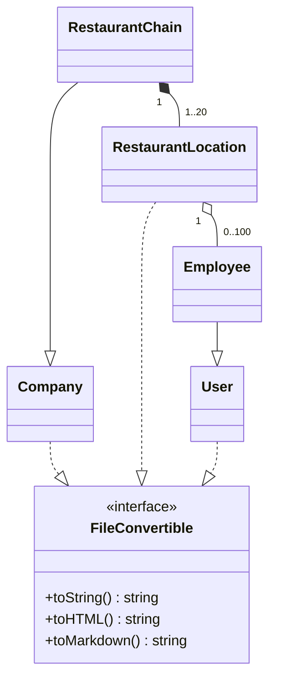

# 01 ARCHITECTURE — 構造と設計判断

## 1. 全体構造

```text
Client: Browser
│  GET /generate.php                   POST /download.php
│  ← HTML with forms                  → URL-encoded form data
│                                    ← HTTP response + file body
└──────────────────────────────┬────────────────────────────────
                               │
PHP server (php -S 127.0.0.1:8000 -t .)
  generate.php  ... GET page, HTML markup
  download.php  ... POST guard / validate / generate / respond
  src/bootstrap.php ... autoload classes when first referenced
    src/Support/RequestValidator.php  ... trust boundary
    src/Support/RandomGenerator.php ... creates typed objects
      src/Support/RandomData.php ... synthetic random strings
      src/Models/User.php
      src/Models/Employee.php extends User
      src/Models/Company.php
      src/Models/RestaurantLocation.php contains Employee[]
      src/Models/RestaurantChain.php extends Company, contains RestaurantLocation[]
      src/Contracts/FileConvertible.php ... representation contract
    src/Support/Exporter.php ... chooses response encoding
      src/Support/Html.php ... HTML / Markdown escapes
```

## 2. ディレクトリの責務

| Path | Purpose | Reads/uses |
|---|---|---|
| `generate.php` | Browser form presentation | Form markup, field() helpers |
| `download.php` | HTTP endpoint and status/headers | Validator, Generator, Exporter |
| `src/bootstrap.php` | Namespace-to-file autoloading | `spl_autoload_register` |
| `src/Models` | Typed domain data and output methods | `FileConvertible`, `RandomData`, `Html` |
| `src/Support/RequestValidator.php` | Pure POST input interpretation | `array`, regex, allowed formats |
| `src/Support/RandomGenerator.php` | Factory for User[] / RestaurantChain[] | Model constructors and `RandomData` |
| `src/Support/Exporter.php` | Output selection, JSON encoding, full HTML document | Model methods |
| `tests` | Unit and real HTTP integration tests | PHP and Python standard libraries |
| `learning` | Independent Japanese technical manual | Actual source code |

## 3. OOP relationship



`Employee` は `User` から ID/氏名/メールを再利用して、jobTitle/salary/startDate/roles を加えます。`RestaurantChain` は `Company` から会社属性を再利用し、chainId や cuisineType などを追加します。`RestaurantLocation` の社員一覧は所有関係として保存されます。`FileConvertible` によって、Exporter は項目の種類を気にせず `toString/toHTML/toMarkdown` を呼び出せます。JSON はインターフェースに含まれていないため `toArray()` を別途用意しました。

## 4. 詳細な処理順序

1. クライアントが `GET /generate.php` にアクセスしてフォームが返る。
2. 送信ボタンを押すと、ブラウザは各 `<input name>` の値をキー・値として送る。`method=post` なので URL query ではなく HTTP body が主体。
3. `download.php` の `require_once` が autoloader を登録する。
4. `$_SERVER['REQUEST_METHOD']` が POST でなければ `405 + Allow: POST` で停止。
5. `RequestValidator::validate($_POST)` が形式・データセットを確定し、数値や範囲を検証する。例外が出ると `412`。
6. User なら `RandomGenerator::users($n,$n)`、Restaurant Chain なら `RandomGenerator::chains(...)` が動く。
7. Factory は型の正しいオブジェクトを生成し、restaurant の場合は Chain → Location → Employee を追加する。
8. Exporter がフォーマットの分岐を行う。`json` なら toArray 配列を `json_encode`、`txt/md/html` なら変換メソッドを呼ぶ。
9. PHP が `Content-Type` および `Content-Disposition` をレスポンスヘッダーに設定する。
10. `echo $export['body']` が本文を送信し、ブラウザは表示または保存する。

## 5. なぜ分離したのか

- `download.php` へすべてを詰め込むと、入力のチェックと出力のバグを別々にテストできない。
- `RequestValidator` は「信頼境界」を担う。呼び出し後は全パラメータが厳密な型と範囲を持つ。
- `RandomGenerator` は作成責務だけ持つ。HTTPや `header()` を知らなくても単体テストできる。
- `Exporter` は見せ方を担当する。ダウンロード形式の追加・変更をモデル生成から独立して扱える。
- Model は「データの意味」と「オブジェクト自身の基本表現」を持つ。

## 6. 重要な状態/副作用

- ランダム生成は `random_int()` を呼び出すので、リクエストのたびに異なる値になる。テストでは具体的な名前ではなく、不変条件（件数、上下限、型）を検証する。
- 各リクエストのオブジェクト配列はそのHTTPレスポンス中だけ存在する。`$_SESSION`、DB、キャッシュ等へ保存しない。
- 連結前のテキストはモデルがHTMLエスケープしており、不要な任意HTMLを注入しない。
- PHP の `header()` は本文を書き出す前に呼び出す必要がある。

## 7. 非採用の方式

- ComposerやFakerへの依存：課題は自前のモデルでも成立するため、インストールを不要にした。
- データベース：ダミーデータの出力目的に永続化は必要ない。
- JavaScriptでだけバリデーション：ブラウザを回避してPOSTができるため不十分。
- 出力データをディスクに保存：`Content-Disposition` を使えば生成した本文をそのまま配信できる。
